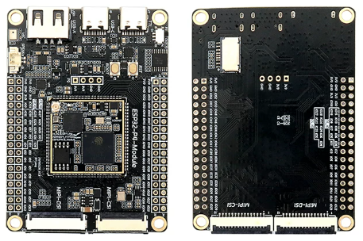
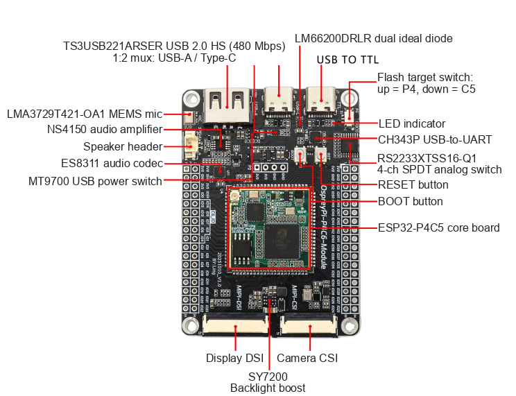
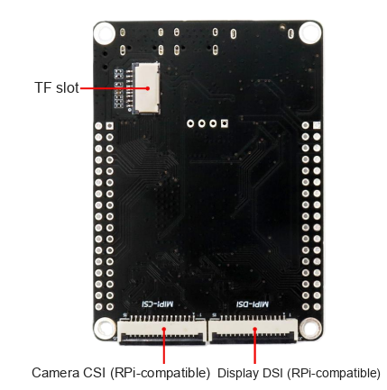
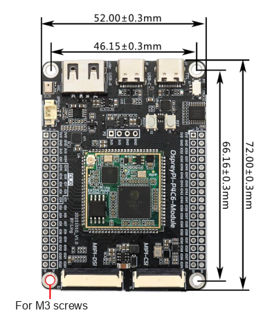
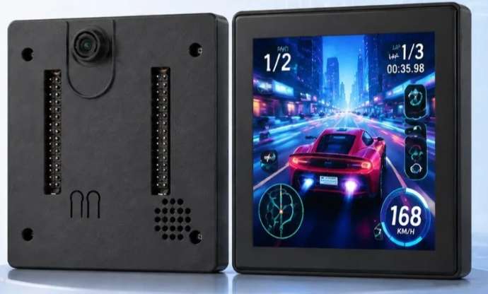
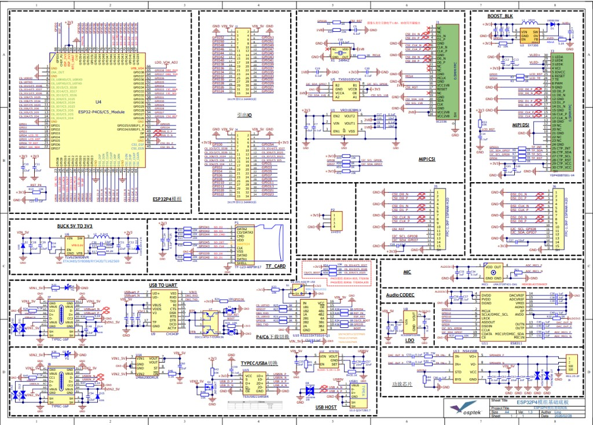

<p align="left"></p>

<h1 align="center">OSPTEK ESP32-P4C5-Module Dev Board</h1>

<p align="center"><b>Ready to Use · Multi-Function Expansion · Full I/O Breakout</b></p>

<p align="center">English | <a href="./README.md">简体中文</a></p>

<p align="center">
  
  
  
  
  
</p>

<p align="center"></p>

## Contents

- [Overview](#overview)
- [Features](#features)
- [Applications](#applications)
- [Specifications](#specifications)
- [Hardware Resources](#hardware-resources)
- [Core Board](#core-board)
- [Compatible Cameras](#compatible-cameras)
- [Get Started](#get-started)
- [Repository Structure](#repository-structure)
- [Documentation](#documentation)
- [Where to Buy](#where-to-buy)
- [Support](#support)
- [License](#license)

---

## Overview

The OSPTEK ESP32-P4C5-Module Dev Board is a multi-function development platform built around the
**ESP32-P4C5 Core Board**. The carrier expands the core board with camera, display, audio, and USB
interfaces plus multi-path power protection, and breaks out 55 programmable GPIOs from ESP32-P4 and
9 GPIOs from ESP32-C5 via 2×2×17 pin headers. You can evaluate and develop without designing your
own carrier board.

The onboard ESP32-P4 integrates two high-performance (HP) RISC-V cores and one low-power (LP) core,
running at up to 400 MHz, with a JPEG codec, Pixel Processing Accelerator (PPA), Image Signal
Processor (ISP), and H.264 video encoder. ESP32-C5 provides Wi-Fi 6 (2.4/5 GHz dual-band),
Bluetooth 5 (LE), and IEEE 802.15.4 (Zigbee / Thread) wireless connectivity.

## Features

- 🚀 **Ready to Use**: core board + carrier in one — power on and start evaluating
- ⚡ **High-Performance Dual-Core**: ESP32-P4 dual-core RISC-V, up to 400 MHz, 16 MB Flash + 32 MB PSRAM
- 🎨 **Rich Multimedia**: JPEG codec, H.264 encoding, PPA, and ISP for image and video workloads
- 📶 **Wireless Connectivity**: Wi-Fi 6 (2.4/5 GHz dual-band), Bluetooth 5 (LE), IEEE 802.15.4 (Zigbee / Thread)
- 📷 **Camera Interfaces**: MIPI-CSI 24P + 15P Raspberry Pi–compatible connector; works with SC2336
- 🖥️ **Display Interfaces**: MIPI-DSI 30P + 15P Raspberry Pi–compatible connector; supports YDP400BT001-V4
- 🔊 **Complete Audio Path**: ES8311 codec + NS4150 3 W Class-D amp + onboard silicon mic
- 🔌 **Rich USB**: 2 × Type-C (data / debug) + USB-A Host, with high-speed USB 2.0 switching
- 🛠️ **Driver-Free Debug**: onboard CH343P USB-UART; toggle switch selects ESP32-P4 or ESP32-C5 flashing target
- 📍 **Full Pin Breakout**: 2×2×17 headers expose 55 ESP32-P4 GPIOs and 9 ESP32-C5 GPIOs
- 🛡️ **Power Protection**: dual ideal diodes for reverse-current blocking; USB-A output with OCP / SCP

## Applications

- 🖥️ HMI (human-machine interface)
- 📷 Vision and image capture
- 🎙️ Voice interaction and audio processing
- 📹 Video encoding and streaming
- 🏠 Smart home control panels
- 🏭 Industrial control and monitoring
- 🤖 Robotics
- 🧠 AIoT edge computing
- 🔌 USB host expansion

## Specifications

### MCU & Memory

| Item       | Specification                                      |
| ---------- | -------------------------------------------------- |
| Core Board | ESP32-P4C5 Core Board (88-pin stamp hole)          |
| Main Chip  | Espressif ESP32-P4 (2 × HP RISC-V + 1 × LP core)   |
| Clock      | Up to 400 MHz                                      |
| ROM        | 128 KB HP ROM + 16 KB LP ROM                       |
| SRAM       | 768 KB HP L2MEM + 32 KB LP SRAM + 8 KB TCM         |
| Flash      | 16 MB serial NOR Flash                             |
| PSRAM      | 32 MB (in-package on ESP32-P4)                     |

### Wireless

| Item          | Specification                             |
| ------------- | ----------------------------------------- |
| Wireless Chip | ESP32-C5                                  |
| Wi-Fi         | Wi-Fi 6 (2.4 / 5 GHz dual-band)           |
| Bluetooth     | Bluetooth 5 (LE)                          |
| Other         | IEEE 802.15.4 (Zigbee / Thread)           |
| Antenna       | IPEX-1 connector on the core board        |

### Camera & Display

| Item              | Specification                                                    |
| ----------------- | ---------------------------------------------------------------- |
| Camera (front)    | MIPI-CSI 24P 0.5 mm top-contact, supports SC2336                 |
| Camera (back)     | MIPI-CSI 15P 1.0 mm top-contact, Raspberry Pi–compatible         |
| Display (front)   | MIPI-DSI 30P 0.5 mm top-contact, supports YDP400BT001-V4         |
| Display (back)    | MIPI-DSI 15P 1.0 mm top-contact, Raspberry Pi–compatible         |
| Backlight Driver  | SY7200 boost constant-current for DSI panels                     |

### Audio

| Item            | Specification                                      |
| --------------- | -------------------------------------------------- |
| Codec           | ES8311 (low-power mono codec)                      |
| Amplifier       | NS4150 (3 W mono Class-D)                          |
| Microphone      | LMA3729T421-OA1 silicon mic (onboard)              |
| Speaker Header  | MX1.25-2P                                          |

### USB & Debug

| Item             | Specification                                                         |
| ---------------- | --------------------------------------------------------------------- |
| Data Port        | Type-C × 1, high-speed USB 2.0 (480 Mbps)                             |
| Debug Port       | Type-C × 1, onboard CH343P USB-UART                                   |
| USB Host         | USB-A × 1                                                             |
| Path Switch      | TS3USB221ARSER 1:2 mux between Type-C and USB-A                       |
| Flash Target     | Slide switch: up = ESP32-P4, down = ESP32-C5                          |
| UART Switch      | RS2233XTSS16-Q1 4-ch SPDT analog switch, driven by the slide switch   |
| Buttons          | RESET (reset), BOOT (download mode)                                   |

### Power Management

| Item           | Specification                                                       |
| -------------- | ------------------------------------------------------------------- |
| Main Supply    | 5 V in, TLV62569 buck to 3.3 V                                      |
| Reverse Protect| LM66200DRLR dual ideal diode (ORing)                                |
| USB-A Output   | MT9700 adjustable current-limit power switch with OCP / SCP         |
| Aux Rails      | Onboard 1.8 V / 2.8 V LDOs for camera and other peripherals         |

### Expansion

| Item          | Specification                                                  |
| ------------- | -------------------------------------------------------------- |
| Headers       | 2 × 2×17P, 2.54 mm pitch                                       |
| Broken-out IO | 55 programmable GPIOs (ESP32-P4) + 9 GPIOs (ESP32-C5)          |
| Storage       | Onboard TF (microSD) slot                                      |

## Hardware Resources

### Front Side Interfaces

<p align="center"></p>

The core board sits in the center; audio, USB, debug and flash-switch circuits are along the top, and
2×2×17 headers around the edge break out all GPIOs. The front MIPI-DSI / MIPI-CSI connectors are at the
bottom. See [Specifications](#specifications) for component details.

### Back Side Interfaces

<p align="center"></p>

Two 15P 1.0 mm MIPI connectors on the back are Raspberry Pi cable–compatible; the TF card slot is
near the top of the back side.

### Dimensions

<p align="center"></p>

| Item            | Dimension                         |
| --------------- | --------------------------------- |
| Board Size      | 72.00 × 52.00 mm (±0.3 mm)        |
| Mounting Pitch  | 66.16 × 46.15 mm (±0.3 mm)        |
| Mounting Holes  | 4 × M3                            |

### Enclosure

Two optional enclosures:

- **4-inch** front/back shells (V1.0) for this board with a matching display. The back shell keeps header windows and a speaker grille; the top has a camera cutout.
- **3.95-inch** camera enclosure with a 180° flip case, for a 3.95-inch display and camera.

<p align="center"></p>

| File | Description |
| ---- | ----------- |
| [Front shell STEP V1.0](./docs/ESP32-P4C5-Module_Enclosure_4inch_Front_V1.0.step) | 4-inch front |
| [Back shell STEP V1.0](./docs/ESP32-P4C5-Module_Enclosure_4inch_Back_V1.0.step) | 4-inch back |
| [3.95-inch camera flip-case STEP](./docs/ESP32-P4C5-Module_Enclosure_3.95inch_CameraFlip180.step) | 3.95-inch camera, 180° flip case |

### Schematic

<p align="center"></p>

Full schematic PDF: [docs/ESP32-P4C5-Module_Schematic_V1.3.pdf](./docs/ESP32-P4C5-Module_Schematic_V1.3.pdf).

### Hardware Revisions

| Date     | Rev  | Changes                                                                                          |
| -------- | ---- | ------------------------------------------------------------------------------------------------ |
| 20251023 | V1.1 | Initial release                                                                                  |
| 20251024 | V1.2 | PCB optimization; added input TVS                                                                |
| 20260228 | V1.3 | MIPI-CSI reset pull-up changed to 1.8 V (open-drain IO recommended); carrier compatible with P4C6 and P4C5 modules |

## Core Board

This dev board carries the **ESP32-P4C5 Core Board** (`esp32-p4c5-core-board`) with all core-board
pins broken out. Specs and pinout details are in its dedicated repositories:

- GitHub: <https://github.com/osptek/esp32-p4c5-core-board>
- Gitee: <https://gitee.com/osptek/esp32-p4c5-core-board>

## Compatible Cameras

Cameras connect over **MIPI-CSI** (front 24P 0.5 mm / back 15P 1.0 mm Raspberry Pi–compatible).
The following models can be used with this board:

| Model  | Interface | GitHub | Gitee |
| ------ | --------- | ------ | ----- |
| SC2336 | MIPI CSI  | [Link](https://github.com/osptek/camera-mipi-csi-sc2336) | [Link](https://gitee.com/osptek/camera-mipi-csi-sc2336) |
| OV2710 | MIPI CSI  | [Link](https://github.com/osptek/camera-mipi-csi-ov2710) | [Link](https://gitee.com/osptek/camera-mipi-csi-ov2710) |

## Get Started

This board is developed with the official **ESP-IDF** ecosystem. For environment setup and flashing,
see Espressif docs:

- [ESP-IDF Get Started · ESP32-P4](https://docs.espressif.com/projects/esp-idf/en/latest/esp32p4/get-started/)
- [ESP-IDF 快速入门 · ESP32-P4（中文）](https://docs.espressif.com/projects/esp-idf/zh_CN/latest/esp32p4/get-started/)

### C5 Wireless Co-processor Firmware

ESP32-P4 has no built-in radio. Wi-Fi / Bluetooth is provided over SDIO by the **ESP32-C5** on the core board.
The C5 runs Espressif's [ESP-Hosted-MCU](https://github.com/espressif/esp-hosted-mcu) co-processor firmware,
and P4 applications use wireless through the `esp_wifi_remote` + `esp_hosted` components.

Below is the prebuilt **C5 firmware** (ESP-Hosted-MCU v2.12.9, SDIO transport, built with ESP-IDF v5.5.4).
**Flash it to ESP32-C5 only — never to ESP32-P4:**

| File | Target | Address | Notes |
| ---- | ------ | ------- | ----- |
| [`ESP32-C5_ESP-Hosted_v2.12.9_merged_0x0.bin`](./firmware/ESP32-C5_ESP-Hosted_v2.12.9_merged_0x0.bin) | ESP32-C5 | `0x0` | Merged image (bootloader + partition table + app) |

Steps:

1. Set the slide switch **down to C5**.
2. Connect the debug Type-C port (CH343P) to your computer.
3. Flash the merged image at `0x0`:

   ```bash
   esptool.py --chip esp32c5 -p <PORT> -b 460800 write_flash 0x0 firmware/ESP32-C5_ESP-Hosted_v2.12.9_merged_0x0.bin
   ```

4. When done, set the switch **back to P4** to develop and flash the P4 application.

> - The merged image must be flashed at **`0x0`**, not at the app offset `0x10000`.
> - Keep the P4-side `esp_hosted` component version in line with the C5 firmware (2.12.x); a large version gap may break host–slave communication.

## Repository Structure

```
devboard-esp32p4c5_module/
├── README.md          # Chinese product docs
├── README_EN.md       # English product docs (this file)
├── docs/              # User guide, schematic, enclosure STEP, camera/antenna files
├── firmware/          # C5 wireless co-processor firmware (ESP-Hosted, flash C5 @ 0x0)
└── images/            # Images used by the README
```

## Documentation

### Product Docs

- [ESP32-P4C5-Module User Guide (EN)](./docs/ESP32-P4C5-Module_UserGuide_EN_20260910.pdf)
- [ESP32-P4C5-Module 使用指南 (CN, includes schematic)](./docs/ESP32-P4C5-Module_UserGuide_CN_20260910.pdf)
- [ESP32-P4C5-Module Carrier Schematic V1.3](./docs/ESP32-P4C5-Module_Schematic_V1.3.pdf)
- [4-inch enclosure front STEP V1.0](./docs/ESP32-P4C5-Module_Enclosure_4inch_Front_V1.0.step)
- [4-inch enclosure back STEP V1.0](./docs/ESP32-P4C5-Module_Enclosure_4inch_Back_V1.0.step)
- [3.95-inch camera 180° flip-case STEP](./docs/ESP32-P4C5-Module_Enclosure_3.95inch_CameraFlip180.step)
- [C5 wireless co-processor firmware, ESP-Hosted v2.12.9 (C5 only, `0x0`)](./firmware/ESP32-C5_ESP-Hosted_v2.12.9_merged_0x0.bin)

### Peripheral Docs

- [SC2336 Datasheet](./docs/SC2336_Datasheet_V0.7.pdf)
- [ESP32-P4-Camera Module Specification](./docs/ESP32-P4-Camera_Spec.pdf)
- [C5 Dual-Band Antenna Materials](./docs/ESP32-C5_DualBand-Antenna_Spec.pdf)
- [2415 Cavity Speaker Specification (8 Ω / 1 W, 1.25 mm pitch 2P connector)](./docs/Speaker-2415_Spec.pdf)

### Chip Docs (Espressif)

- [ESP32-P4 Datasheet v1.3](https://documentation.espressif.com/esp32-p4-chip-revision-v1.3_datasheet_en.html)
- [ESP32-P4 Technical Reference Manual v1.3](https://documentation.espressif.com/esp32-p4-chip-revision-v1.3_technical_reference_manual_en.pdf)
- [ESP32-P4 Product Page](https://www.espressif.com/en/producttype/esp32-p4)
- [ESP32-C5 Datasheet](https://documentation.espressif.com/esp32-c5_datasheet_en.html)
- [ESP32-C5 Product Page](https://www.espressif.com/en/products/socs/esp32-c5)

### Development Guides

- [ESP-IDF Programming Guide · ESP32-P4](https://docs.espressif.com/projects/esp-idf/en/latest/esp32p4/index.html)
- [ESP-IDF Get Started · ESP32-P4](https://docs.espressif.com/projects/esp-idf/en/latest/esp32p4/get-started/)

## Where to Buy

<p align="center">
  <a href="https://www.aliexpress.com/store/1105701619"></a>
  &nbsp;&nbsp;
  <a href="https://shop110742373.taobao.com/"></a>
</p>

**International (AliExpress)**

- Store: [OSPTEK Official Store](https://www.aliexpress.com/store/1105701619)

**China (Taobao)**

- Store: [鱼鹰光电工厂店](https://shop110742373.taobao.com/)

---

## Support

For technical questions or business inquiries, feel free to contact us:

- 📧 Technical Support / Sales: <luyu@osptek.com>
- 🐧 QQ Technical Group: **985881096**
- 🌐 Website: <https://osptek.com/>
- Feel free to open an Issue in this repository if you have any questions

## License

- Repository materials (docs, schematics, enclosure models, images, etc.): [CC BY-NC-SA 4.0](./LICENSE). Credit OSPTEK when sharing or adapting; non-commercial use only. Contact us for commercial licensing.
- The C5 firmware in `firmware/` is built from Espressif ESP-Hosted-MCU and remains under Apache-2.0.
- Third-party materials (e.g. the SC2336 datasheet) remain the property of their respective owners.

---

<p align="center"><sub>© 2026 OSPTEK · Licensed under CC BY-NC-SA 4.0</sub></p>
